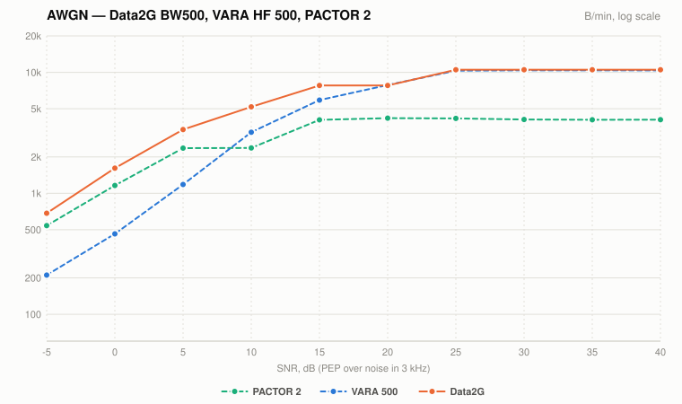
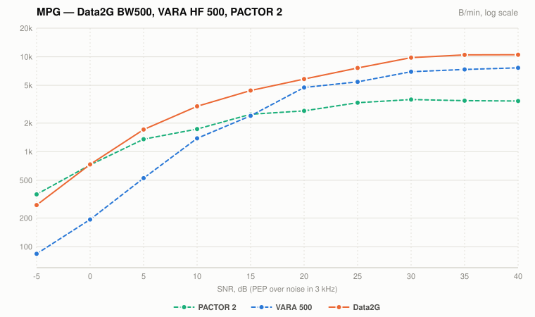
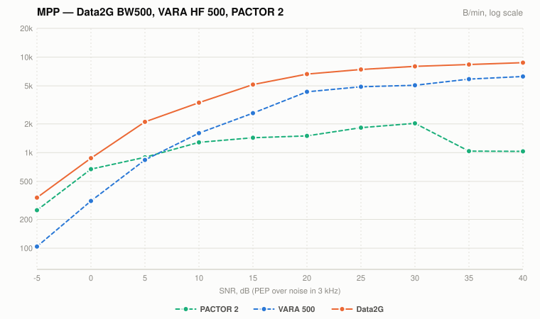

# Data2G and VARA HF 500 against the IONOS SIM paper

<!-- Generated by make_charts.py; edit the data there and re-run. -->

Payload throughput against SNR (PEP over noise in 3 kHz), mean of the middle 3
of 5 seeds.

- **Data2G** at its 500 Hz cap (BW500) is our speed test: the same channel
  model (`noise.py`, `channel.py`) simulated, with the host's turnaround
  latency.
- **VARA HF 500** (VARA 4.0) and **PACTOR 2** are the IONOS SIM paper's
  figures, from the March 2021 spreadsheet, HF 500 sheet, on WGN, MPG 2 and
  MPP 2.

The solid line is Data2G (simulated); dashed lines are the paper (IONOS SIM).
Hollow points average fewer than 5 good seeds and are left off the line. The
y axis is log scale: a horizontal gap between the lines is the same number of
dB at any rate.

AWGN is additive white Gaussian noise (the paper's WGN); MPG and MPP are CCIR
"good" and "poor" multipath, simulated with 2 rays (the paper's MPG 2 and
MPP 2).

### AWGN

### MPG

### MPP

## Notes

- Message sizes are the paper's VARA 500 sizes for each point (137,007 B at
  high SNR, down to 8,640 B), so Data2G and VARA include the same start-up
  share. PACTOR 2 used smaller files in the paper (69,311 B on WGN, 19,451 B
  on fading, down to 8,654 B), which costs it some rate to start-up.

## Table

B/min. A count in brackets marks a Data2G figure averaged over fewer than 5
seeds.

| SNR | AWGN Data2G | AWGN VARA 500 | AWGN PACTOR 2 | MPG Data2G | MPG VARA 500 | MPG PACTOR 2 | MPP Data2G | MPP VARA 500 | MPP PACTOR 2 |
|---:|---:|---:|---:|---:|---:|---:|---:|---:|---:|
| 40 dB | 10,503 | 10,377 | 4,060 | 10,503 | 7,640 | 3,416 | 8,747 | 6,269 | 1,031 |
| 35 dB | 10,503 | 10,388 | 4,052 | 10,463 | 7,344 | 3,450 | 8,367 | 5,883 | 1,037 |
| 30 dB | 10,503 | 10,402 | 4,074 | 9,788 | 6,955 | 3,544 | 8,000 | 5,072 | 2,028 |
| 25 dB | 10,503 | 10,322 | 4,163 | 7,621 | 5,443 | 3,283 | 7,422 | 4,897 | 1,825 |
| 20 dB | 7,789 | 7,853 | 4,183 | 5,827 | 4,749 | 2,691 | 6,647 | 4,336 | 1,497 |
| 15 dB | 7,794 | 5,897 | 4,049 | 4,407 | 2,389 | 2,480 | 5,159 | 2,590 | 1,432 |
| 10 dB | 5,184 | 3,199 | 2,372 | 3,008 | 1,382 | 1,731 | 3,340 | 1,601 | 1,282 |
| 5 dB | 3,367 | 1,183 | 2,362 | 1,710 | 526 | 1,353 | 2,101 | 839 | 894 |
| 0 dB | 1,614 | 462 | 1,161 | 734 | 193 | 726 | 876 | 312 | 672 |
| -5 dB | 685 | 211 | 541 | 274 | 84 | 355 | 338 | 104 | 250 |
